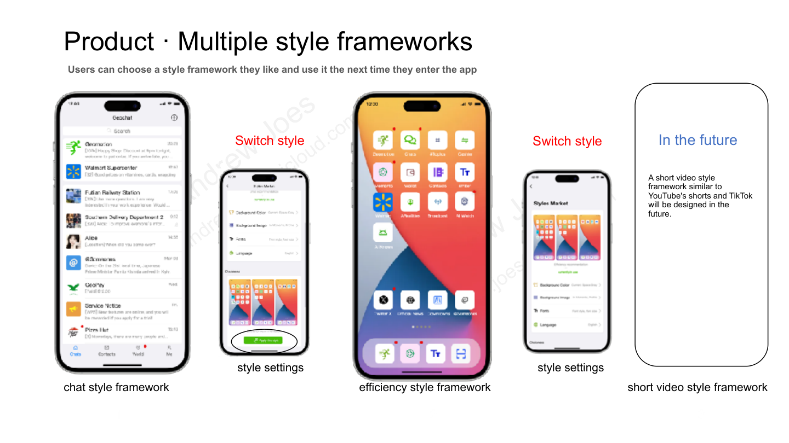

# Geochat
### Business Plan · v4.3

**A real-time geosocial mobile platform**

> Open up the world around you

## [Read the visual business plan →](BP.md)

The complete 46-page English deck, with slides displayed directly and organized into seven chapters. App screens, diagrams and original slide layouts stay intact. Click a slide for the full-size image.

### Explore

- [Vision & positioning](BP.md#vision)
- [Prototype & app experience](BP.md#experience)
- [Product walkthrough](BP.md#product)
- [Finance & incentives](BP.md#finance)
- [Ecosystem, roadmap & business](BP.md#business)
- [Technology, founder & financing](BP.md#company)
- [Historical appendix: Geochat v1.0](BP.md#history)

### Text & source

[Search or copy the source text](TRANSCRIPT.md) · [Conversion report](conversion-report.json)

This repository is a faithful format conversion of `Geochat-BP-v4.3.pdf`, not an updated business plan or a statement of current product completion. Original wording, dates, forecasts and claims are retained, except for an owner-requested edit to the founder biography on page 35. The v1.0 history is clearly separated from the main proposal.

`BP.md` is the visual reading edition. `TRANSCRIPT.md` contains the extracted text with the same founder-biography edit; chart labels and columns should be read in their slide context. The 46 page renders are in `assets/` (page 35 includes the owner-requested edit), including image-only text, screenshots, QR codes and certificates. Repeated diagonal watermarks are omitted from extracted text only.

Keep the Markdown files and the `assets` directory together so navigation and image links work.
